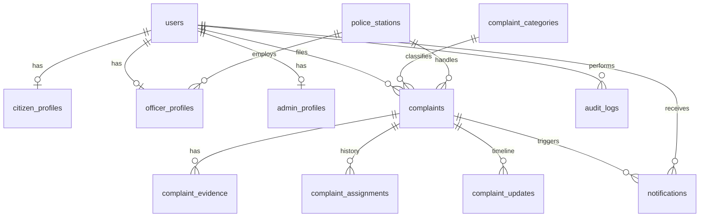

# Database Design
Database `digital_police_portal` · InnoDB · utf8mb4 / `utf8mb4_unicode_ci` · timestamps stored in UTC.
Source of truth: `database/schema.sql` (14 tables). Seed data: `database/seed.sql`.

## Relationships

## Tables
| Table | Purpose | Key points |
|---|---|---|
| users | Auth identity for all roles | `user_id` (CIT-/OFF-/ADM-######) unique; email + phone unique; role/status ENUMs; CHECK ties role to ID prefix |
| citizen_profiles | Citizen address data | 1:1 with users, CASCADE delete, pincode CHECK |
| officer_profiles | Designation, department, station | 1:1 with users; FK to police_stations; `created_by` = admin |
| admin_profiles | Admin details | 1:1 with users |
| police_stations | Station directory | `station_code` unique, `is_active` flag (deactivate instead of delete) |
| complaint_categories | Admin-managed categories | name unique, `is_active` |
| complaint_sequences | Atomic yearly counter | Generates `DPP-YYYY-NNNNNN` without race conditions (SQL snippet in schema.sql) |
| complaints | Core record | public `complaint_ref` unique; CHECK on ref format; CHECK that REJECTED needs `rejection_reason`; `assigned_officer_id` is a denormalised copy of the current assignment |
| complaint_evidence | File metadata | random `stored_filename`, MIME, extension, size, SHA-256; `evidence_type` separates citizen evidence from investigation documents; no path stored |
| complaint_assignments | Assignment history | generated column + UNIQUE key guarantees at most one current assignment per complaint |
| complaint_updates | Status timeline + remarks | `old_status`/`new_status`; `is_visible_to_citizen=0` for internal notes |
| notifications | In-app notifications | indexed by (user, is_read, created_at) |
| audit_logs | Security/admin trail | append-only; JSON `details` (no secrets); actor FK SET NULL so history survives user removal |
| login_attempts | Rate limiting | indexed by (identifier, time) and (ip, time); old rows purged by the app |

## Delete policy
Users and complaints are **never hard-deleted** by the application (deactivate via `status`). FKs from complaints, evidence, assignments and updates to users have no cascade, so accidental deletion is blocked by the database. Profile tables, notifications and a complaint's own evidence/updates cascade.

## Status workflow (enforced in PHP in Phases 6–8; DB enforces valid values only)
| From | Allowed next statuses | Who |
|---|---|---|
| SUBMITTED | UNDER_REVIEW, REJECTED | Admin |
| UNDER_REVIEW | ASSIGNED, REJECTED | Admin (assigning sets ASSIGNED) |
| ASSIGNED | INVESTIGATION_IN_PROGRESS, REJECTED | Assigned officer / Admin |
| INVESTIGATION_IN_PROGRESS | RESOLVED, REJECTED | Assigned officer / Admin |
| RESOLVED | CLOSED | Officer / Admin |
| CLOSED, REJECTED | none (terminal) | n/a |

Re-assignment keeps the status and closes the old assignment row. Every transition writes a `complaint_updates` row, a notification and (for admin/officer actions) an `audit_logs` row, in one transaction. This table is a design decision; adjust it before Phase 6 if your process differs.

## Complaint reference generation
Inside the submit transaction, bump `complaint_sequences` for the current year and format `DPP-{year}-{number padded to 6}`. The auto-increment `id` is never returned by any API.

## Compatibility notes
- Verified for syntax with a MySQL-dialect parser only; **not yet imported into a live server**. Import it in phpMyAdmin and report any error.
- XAMPP usually ships MariaDB, not MySQL 8. The schema avoids MySQL-8-only collations for that reason; CHECK constraints need MariaDB 10.2+/MySQL 8.0.16+.
- If your cloud provider forbids `SET time_zone`, delete that line.
